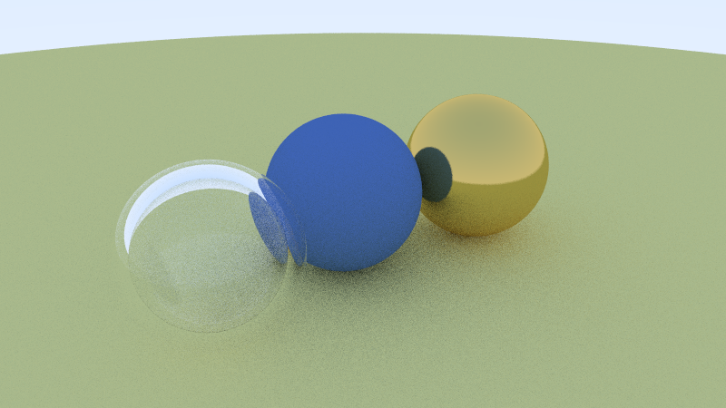

## Strata

Strata is a desktop app for my investments. It keeps accounts, depots and transactions in
SQLite and shows performance, risk, allocation and reports. It imports bank exports and loads
prices from the web. It is written in Fels with the imgui, sqlite, http and decimal packages. It
is not public yet, and its screens are in German for now.

## Packages

| Package | What it does |
| --- | --- |
| [imgui](https://github.com/fels-lang/imgui) | Dear ImGui with docking, a ready window and ImPlot charts |
| [sqlite](https://github.com/fels-lang/sqlite) | SQLite 3 |
| [http](https://github.com/fels-lang/http) | HTTP and HTTPS through WinHTTP |
| [decimal](https://github.com/fels-lang/decimal) | Exact decimal numbers for money |

`fels add imgui github.com/fels-lang/imgui` adds one to your project. [Packages](/docs/packages/)
explains how they work.

The standard library comes with Fels: collections, files, processes, threads, sockets, JSON,
CSV, dates and more. [Standard library](/docs/stdlib/) lists it.

## Examples

The [examples](https://github.com/fels-lang/fels/tree/main/examples) folder has more to look at:

- `raytracer` renders spheres of glass and metal into a BMP file.
- `mandel` draws a Mandelbrot set, all of it computed at compile time.
- `raycaster` lets you walk through a 3D maze in the terminal.
- `diskscan` is a disk analyzer with a Win32 GUI and threads.
- `threads` shows a zone of threads, a pool over all cores and a channel.
- `uefi`, `kernel` and `kernel_aarch64` boot in QEMU.
- `ecs_game`, `bf` (a Brainfuck interpreter), `dll`, `capability` and more.

